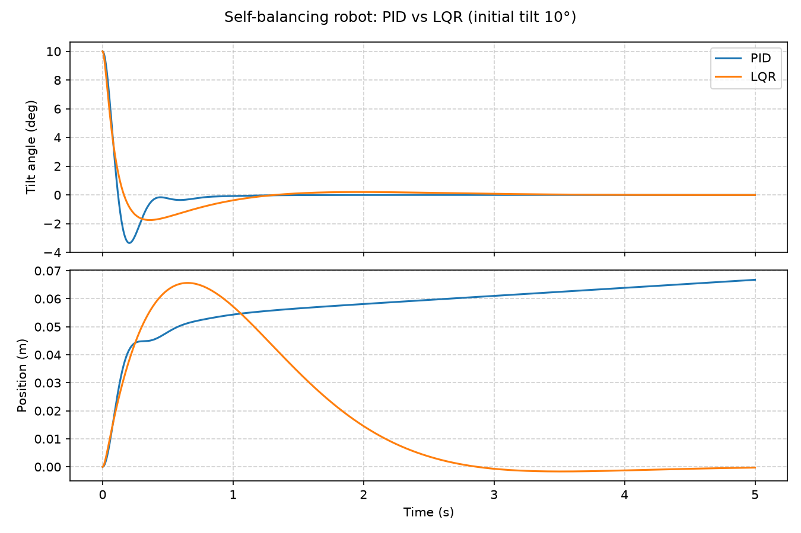

# Self-Balancing Robot (ESP32 + MPU6050)

A two-wheeled self-balancing robot: custom PCB, 3D-printed frame, MicroPython firmware on an ESP32, a PID controller running on the real robot, and an LQR controller compared against it in simulation.


## Hardware
| Part | Details |
|---|---|
| MCU | ESP32 running MicroPython |
| IMU | MPU6050 over I2C at 400 kHz (SDA 22, SCL 23) |
| Motor driver | Dual H-bridge, 2 kHz PWM (channel A: 25/27/26, channel B: 13/14/12) |
| PCB | Designed in KiCad (`hardware/pcb/`) |
| Frame | 3D model for FDM printing (`hardware/3d-model/`) |

## Layout
```
firmware/main.py                # reads the MPU6050, complementary filter, PID, fall detection
analysis/nichols.py             # finds the ultimate period Tu from Teleplot data, Ziegler-Nichols gains
analysis/data_compare_angle.py  # ITAE of the measured angle, per 1-second window
analysis/*.csv, *.xlsx          # tilt angle logged on the robot
simulation/pid_vs_lqr.py        # cart-pole simulation, PID vs LQR
hardware/                       # PCB and 3D files
docs/                           # plots
```

## How it works
**Tilt estimate.** A complementary filter fuses the accelerometer angle with the integrated gyro rate:

$$\theta_k = \alpha(\theta_{k-1} + \omega\,\Delta t) + (1-\alpha)\,\theta_{acc}, \quad \alpha = 0.98$$

**PID on the robot.** The controller acts on the tilt error around the balance point, with a ±0.2° dead band and a clamped integral term. Motors cut out when the tilt exceeds 45° or the I2C read fails, and restart once the robot is held upright again.

Gains were found with the Ziegler-Nichols method: raise Kp until the robot oscillates steadily (Ku = 120), measure the period Tu from the logged data with `analysis/nichols.py`, then tune by hand. Final gains: Kp = 120, Ki = 550, Kd = 0.2.

**LQR in simulation.** The cart-pole model is linearised about upright and the Riccati equation gives `u = -Kx`. PID only controls the angle; LQR controls position and velocity as well, so the robot does not drift.



From the same 10° initial tilt, both controllers keep the robot up. With PID it drifts about 7 cm and keeps moving; with LQR it returns to its starting position.

## Running
```bash
# Flash the firmware (Thonny or mpremote)
mpremote cp firmware/main.py :main.py

# Analysis and simulation
pip install numpy scipy matplotlib pandas
cd analysis && python nichols.py
cd ../simulation && python pid_vs_lqr.py
```

## Next steps
- Run LQR on the robot. This needs wheel encoders for the velocity states.
- Try MPC and compare it with LQR.
