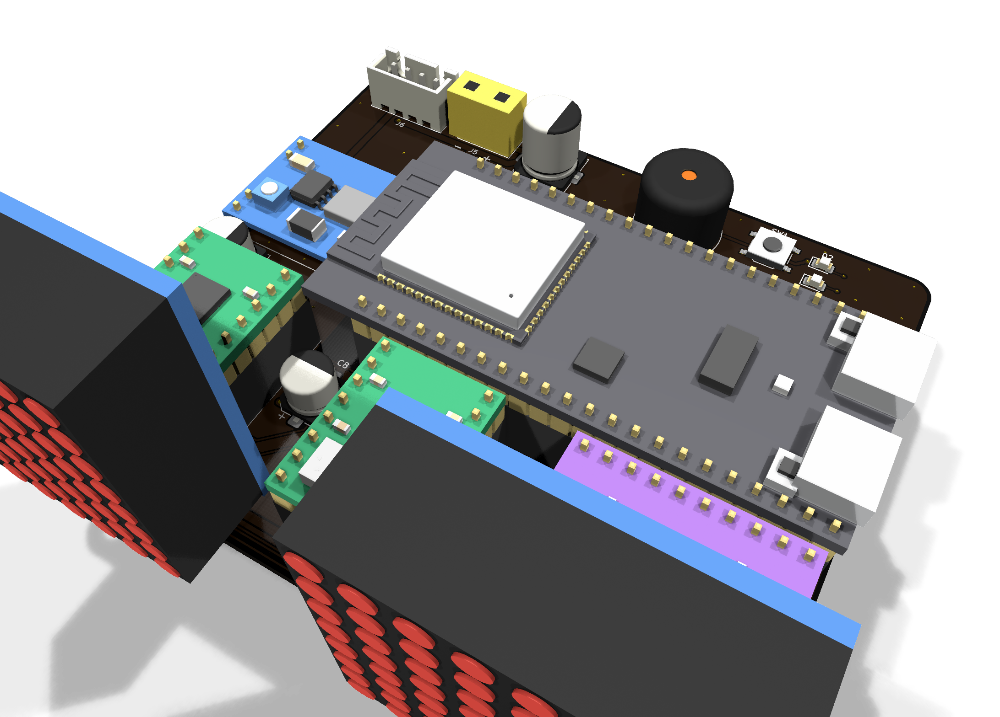
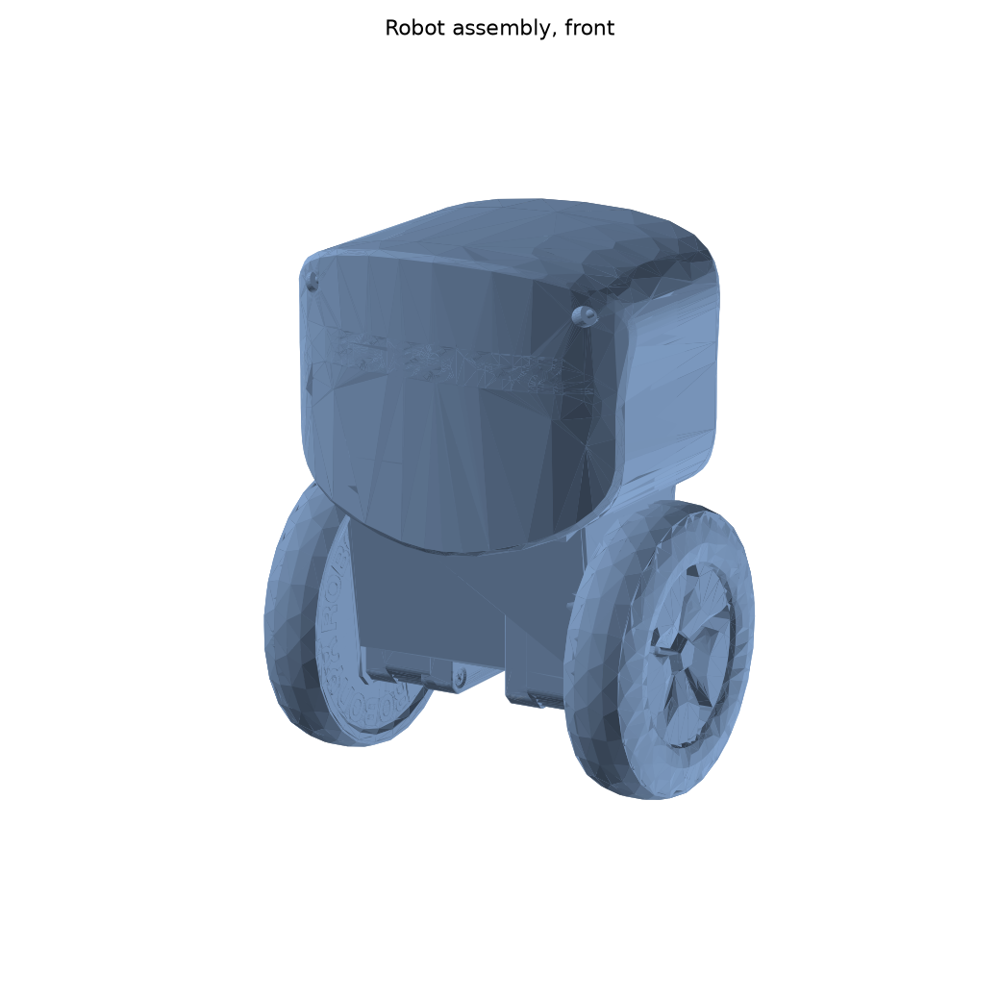
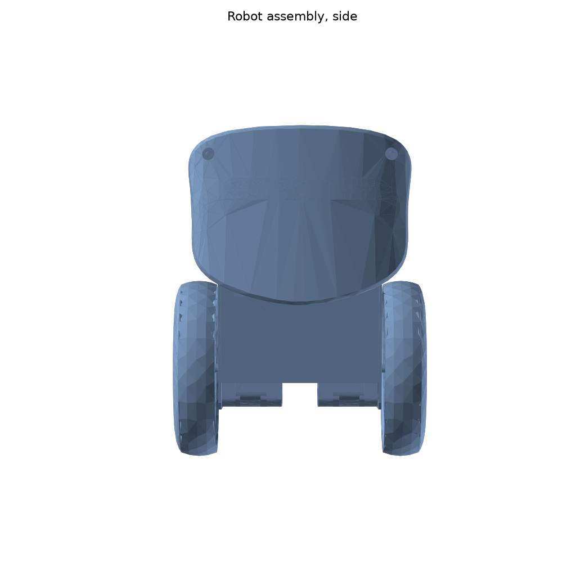
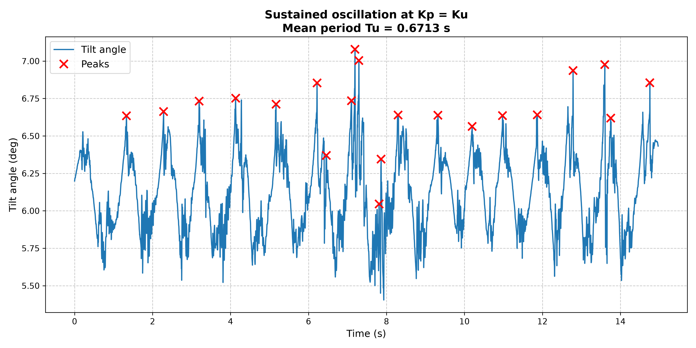
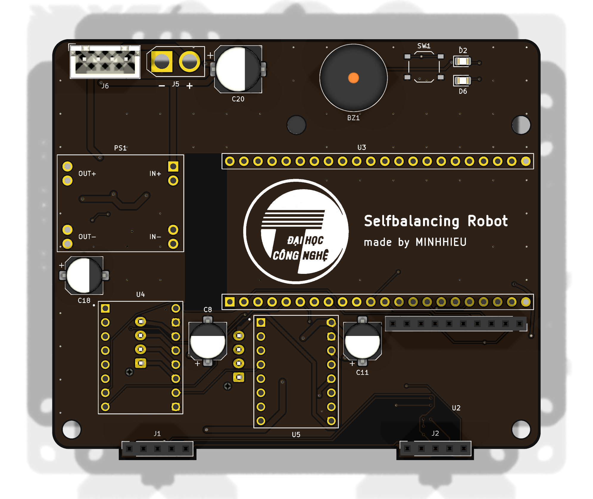
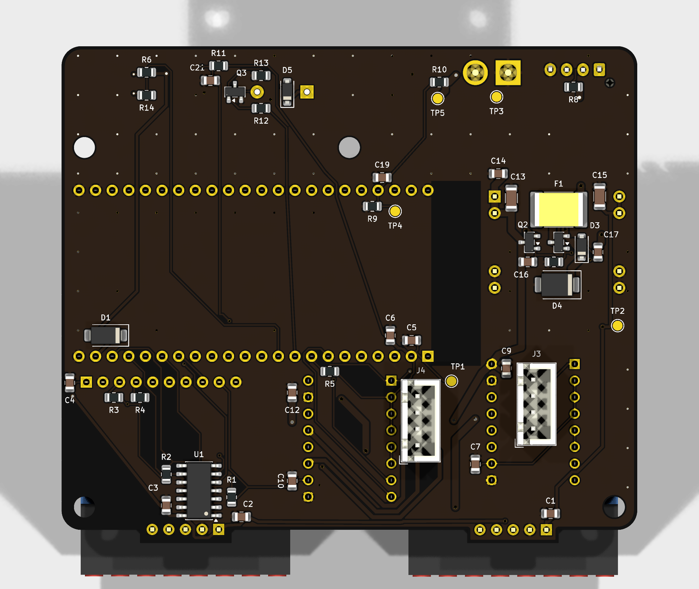
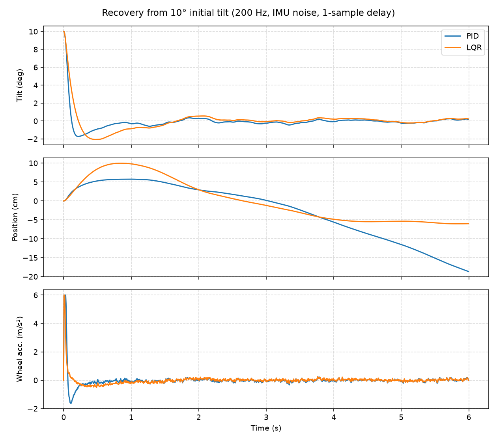
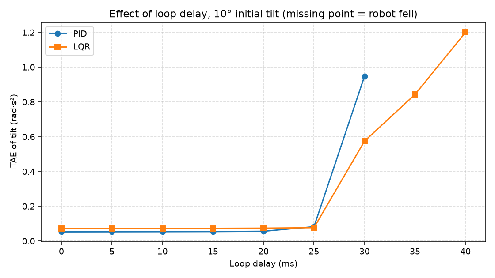
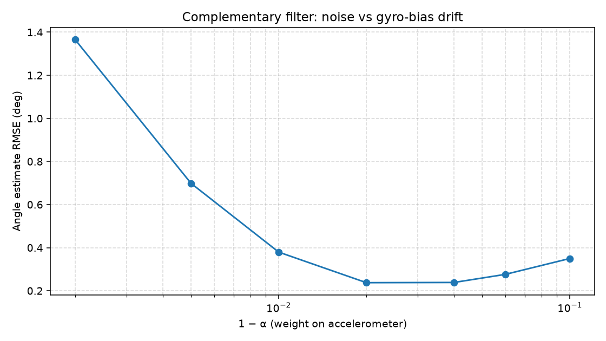

# Self-Balancing Robot

Two-wheeled self-balancing robot, built in two versions:

- **v1**: ESP32 + MPU6050 + DC gear motors, MicroPython, PID tuned on the real robot with Ziegler-Nichols.
- **SBR3**: my redesign of the SBR2.1 main board for a stepper-driven robot. ESP32-S3, two A4988 drivers, MPU-9250 IMU, two MAX7219 LED "eyes", 3S LiPo with soft-start, reverse-polarity and surge protection. Designed in Zener/KiCad, checked with DRC, ERC, SPICE and 269 automated board checks.



|  |  |
|---|---|

## Repository layout
```
v1-micropython/
  firmware/main.py           MPU6050, complementary filter, PID, fall detection
  analysis/nichols.py        ultimate period Tu from logged data, Ziegler-Nichols gains
  analysis/data_compare_angle.py   ITAE of the measured angle per 1 s window
  analysis/*.csv, *.xlsx     tilt angle logged on the robot
sbr3/
  kicad/                     schematic and PCB (KiCad 10)
  gerber/, SBR3_gerber_jlcpcb.zip   fabrication files
  SBR3_BOM.csv, BOM_NOTES.md
  docs/                      schematic PDF, copper plots, 3D renders, DRC report, SPICE results
  zener/                     Zener HDL source, SPICE testbenches, board check script and report
  firmware/sbr3_hw_test/     bring-up test for every block on the board
mechanical/                  robot assembly (STEP) and renders
simulation/                  200 Hz balancing simulation, PID vs LQR
docs/                        plots
```

## v1: PID on the real robot
The tilt angle comes from a complementary filter on the accelerometer angle and the integrated gyro rate:

$$\theta_k = \alpha(\theta_{k-1} + \omega\,\Delta t) + (1-\alpha)\,\theta_{acc}, \quad \alpha = 0.98$$

The PID works on the tilt error with a ±0.2° dead band and a clamped integral. The motors stop past 45° or on an I2C error and restart once the robot is upright.

Tuning started from Ziegler-Nichols. Kp was raised until the robot oscillated steadily at Ku = 120; `nichols.py` finds the peaks in the Teleplot log and gives Tu = 0.671 s, so Kp = 72, Ki = 214.5, Kd = 6.04. Final gains after hand tuning: Kp = 120, Ki = 550, Kd = 0.2.



## SBR3 main board
| Block | Parts |
|---|---|
| MCU | ESP32-S3-DevKitC-1 |
| Motors | 2 × A4988, 1/16 microstepping, shared enable |
| IMU | GY-9250 (MPU-9250) on I2C, interrupt line |
| Eyes | 2 × MAX7219 8×8 modules through a 74AHCT125 level shifter |
| Power | XT30, PTC fuse, AO3401A reverse-polarity FET + soft-start FET, SMBJ15A TVS, MP1584EN buck to 5 V, battery voltage divider to ADC |
| UI | buzzer, button, power and status LEDs |

Power-on inrush was 46 A in simulation before the soft-start was added and 0.91 A after. All SPICE results are in [sbr3/docs/spice_results.md](sbr3/docs/spice_results.md); KiCad DRC reports 0 violations and 0 unconnected items, and [the board check report](sbr3/zener/tests/REPORT.md) lists 269 passing checks (netlist match, track widths, clearances, part ratings, fit inside the robot shell).

| Top | Bottom |
|---|---|
|  |  |

`sbr3/firmware/sbr3_hw_test` tests each block from a serial menu (LED, buzzer, button, battery ADC, IMU WHO_AM_I and readings, eye displays, each motor) and prints a PASS/FAIL summary.

## Simulation: PID vs LQR on SBR3
Steppers set wheel acceleration directly, so the model is a wheeled inverted pendulum with wheel acceleration as input. The loop runs at 200 Hz on a complementary-filter angle estimate from a noisy accelerometer and a biased gyro, with one sample of delay and the stepper's acceleration and speed limits. Logs are in `simulation/results/`.

```bash
pip install numpy scipy matplotlib
cd simulation && python balance_sim.py
```



| Scenario | Controller | ITAE | Max tilt | Settling (±1°) | Final position offset |
|---|---|---|---|---|---|
| 10° initial tilt | PID | 0.053 | 10.0° | 0.46 s | 18.6 cm, still drifting |
| 10° initial tilt | LQR | 0.072 | 10.0° | 0.88 s | 6.0 cm |
| Push, +60°/s | PID | 0.061 | 1.2° | 0.04 s | 8.3 cm |
| Push, +60°/s | LQR | 0.081 | 1.3° | 0.46 s | 6.0 cm |

PID brings the angle back faster, but it has no position feedback beyond a weak speed term, so the robot keeps rolling. LQR is slower on the angle and holds position. The remaining 6 cm offset comes from the gyro bias leaking into the angle estimate.



Both controllers barely change up to 20 ms of delay. PID falls at 35 ms; LQR still balances at 40 ms.



The angle estimate is best around α = 0.96–0.98. Lower α lets accelerometer noise through, higher α lets the gyro bias drift in.

## Credits
- **Robot model.** `mechanical/robot_assembly.step` is "Self-Balancing Robot" by [Mr Robonyx](https://grabcad.com/mr.robonyx-1), downloaded from [GrabCAD](https://grabcad.com/library/self-balancing-robot-13) (uploaded 17 February 2025, [video](https://youtu.be/UwOCjUQFoeM)). It is not my design and is included unchanged; the renders in `mechanical/` are made from it with `render_step.py`. Use of the file is subject to the [GrabCAD terms of use](https://grabcad.com/terms).
- **SBR2.1 board.** SBR3 is a redesign of the SBR2.1 main board by H.M. Phan (Robonyx); the SBR3 board was laid out to fit inside the robot model above.
